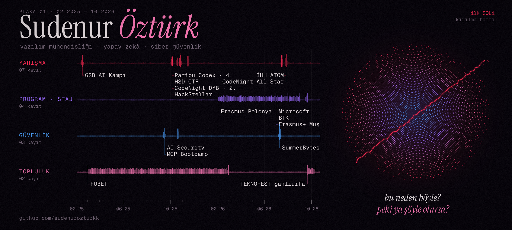
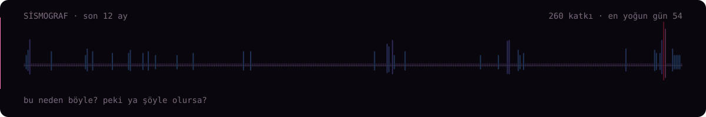

  

  

### Hakkımda

Yazılım mühendisliği öğrencisiyim (Fırat Üniversitesi). Yapay zekâ ürünleri geliştiriyorum, siber güvenlikle uğraşıyorum; sistemlerin nasıl çalıştığıyla ve **nerede kırıldığıyla** ilgileniyorum. İlk CTF'imi SQL injection ile çözdüm.

> *"Bu neden böyle? Peki ya şöyle olursa ne olur?"*

**Şu an:** yazılım stüdyom [Whodenur](https://www.whodenur.com)'u kuruyorum · yapay zekâ ve güvenlik üzerine çalışıyorum

### Projeler

| Proje | Ne yapıyor | Teknoloji |
|---|---|---|
| **GENÇ İHH Raporlama** | AI destekli saha raporlama: rol bazlı erişim, değiştirilemez rapor arşivi, Türkiye haritası, AI özetleri. İHH ATOM Hackathon | Next.js 16 · React 19 · Prisma · PostgreSQL · Claude |
| **CampaignCell** | Kişiselleştirilmiş kampanya platformu, 4 mikroservis + API Gateway, segmentasyon ve dönüşüm tahmini. Turkcell CodeNight All Star | NestJS · FastAPI · RabbitMQ · scikit-learn · Docker |
| **İlaç Rehberi Asistanı** | Tamamen offline RAG ilaç rehberi: hibrit arama, zorunlu kaynak gösterimi, sesli soru, etkileşim kontrolü. Microsoft stajı | Next.js 15 · SQLite · Foundry Local · Whisper |
| **SürüCep** | Küçük besiciler için offline-first PWA: aşı, doğum, tedavi, süt kaydı ve ilaçlı sütün satışını engelleyen uyarılar | React · TypeScript · PWA |
| **KulüpOS** | Hacktoberfest Elazığ 2026 için tek başıma geliştirdiğim kulüp yönetim uygulaması | Gemma (açık model) |
| **AI Finans Asistanı** | Anomali tespiti, 30 günlük tahmin, senaryo simülasyonu yapan agentic finans danışmanı | Next.js · Gemini · TypeScript |
| **SmartRentVault** | 48 saatte yazılan merkeziyetsiz kira/depozito dApp'i: escrow, puanlama, cüzdan entegrasyonu. HackStellar | Rust · Soroban · Stellar · React |
| **DiyetPro** | Diyetisyen hasta takip masaüstü uygulaması; hazır framework olmadan katmanlı mimari ve kendi DI container'ı | C# · .NET 4.8 · DevExpress · MySQL |
| **FitTurkAI** | Türkçe sağlık ve fitness takip asistanı | Next.js · FastAPI · Hugging Face |
| **QR Menü** | Diyarbakır'da bir kafe için gönüllü dijital menü | HTML · CSS · JavaScript |

### Yol haritası

- **2026** · Erasmus+ Polonya (Częstochowa) · Microsoft AI Innovators stajı · BTK stajı · CodeNight All Star finali · İHH ATOM Hackathon · SummerBytes saldırgan güvenlik kampı · Erasmus+ Muş projesi
- **2025** · Paribu Codex 4.'lüğü · CodeNight Diyarbakır 2.'liği · HackStellar · MCP Bootcamp · AI Security eğitimi · FÜBET etkinlik koordinatörlüğü
- **2025 başı** · GSB Yapay Zekâ Kış Kampı, ByteGirls takım kaptanı (20 takım arasında ilk 8)

### Araç çantası

`TypeScript` `Next.js` `React` `Python` `Java` `C# / .NET` `Rust` `PostgreSQL` `Docker` `RabbitMQ` `RAG / LLM` `Hugging Face` `OWASP` `CTF`

### İletişim

[sudenurozturk.tr](https://www.sudenurozturk.tr) · [whodenur.com](https://www.whodenur.com) · [Hugging Face](https://huggingface.co/sudenurozturk) · [LinkedIn](https://linkedin.com/in/sudenurozturk) · whodenur@gmail.com
