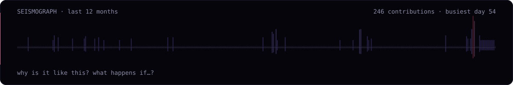

<b>EN</b> · <a href="README.tr.md">TR</a>

  

  

  
  
  

I'm a software engineering student at Fırat University. I build AI products and dig into cybersecurity; I'm curious how systems actually work and **where they break**. I solved my first CTF with SQL injection.

**Right now:** building my software studio [Whodenur](https://www.whodenur.com) · working on AI and security

  
  
  
  
  
  
  
  
  
  

  

  

  
  
  
  

