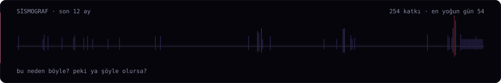

<a href="README.md">EN</a> · <b>TR</b>

  

  

  
  
  

Yazılım mühendisliği öğrencisiyim (Fırat Üniversitesi). Yapay zekâ ürünleri geliştiriyorum, siber güvenlikle uğraşıyorum; sistemlerin nasıl çalıştığıyla ve **nerede kırıldığıyla** ilgileniyorum. İlk CTF'imi SQL injection ile çözdüm.

**Şu an:** yazılım stüdyom [Whodenur](https://www.whodenur.com)'u kuruyorum · yapay zekâ ve güvenlik üzerine çalışıyorum

  
  
  
  
  
  
  
  
  
  

  

  

  
  
  
  

